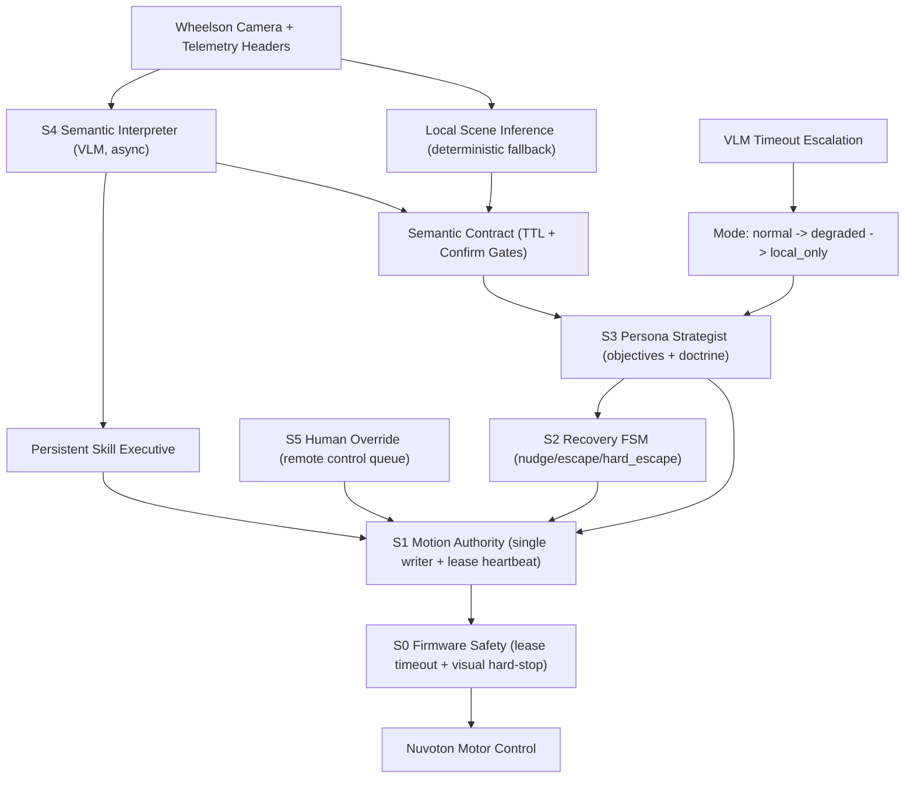

# Wheelson Explorer

Autonomous exploration stack for CircuitMess Wheelson using a **subsumption-type architecture**:
- firmware safety/reflexes,
- deterministic local planning,
- async VLM scene semantics,
- persona-specific strategy,
- **remote human override** with queued multi-viewer control.

The system is designed so robot motion remains safe and deterministic even when VLM calls are slow or unavailable — and human operators can take direct control at any time via the live dashboard.

**Protocol 2 requires the matching firmware and middleware.** See
[Motion and planning](docs/CONTROL.md) for the command protocol, timing, LLM skill
contract, validation commands and floor-tuning procedure.

## Architecture (Subsumption-Type)

Control is layered by priority. Higher-priority layers can suppress lower-priority intent.

1. **S0 Firmware Safety and Motor Control**
- Dedicated 50 Hz motor task with fractional intensity easing
- Independent 750 ms lease watchdog for continuous and timed movement
- Forward stop on stale image analysis; emergency stops bypass easing
- Visual obstacle hard-stop (`visual_obstacle` latch)
- Exposes camera + telemetry headers + active command metadata

2. **S1 Motion Authority (middleware)**
- Single writer to `/move` (`MotionSupervisor`)
- Identity-only renewal for continuous and timed motion; session/sequence ordering in firmware
- Command metadata propagation (`command_id`, `source`, `mode`)
- Local 10 Hz target cadence, independent camera producer, live steering during latched maneuvers

3. **S2 Recovery FSM (middleware)**
- Deterministic nudge/escape/hard-escape escalation
- Sustained motion-score stall detection with acceleration settling
- Non-blocking steps, cancelled atomically by human takeover

4. **S3 Persona Strategist (middleware)**
- Persona-specific motion doctrine and objectives
- Distinct policies for `benson`, `sir_david`, `klaus`, `zog7`
- Can be switched live via dashboard or `POST /persona` without restarting

5. **S4 LLM Strategist and Skill Executive (async, locally constrained)**
- VLM outputs scene semantics (`frontier`, `traversability`, `novelty`, `hazard`, `headlight`, `observation`) plus persona commentary text (`commentary`)
- Optional objective and up to three validated explore/follow_boundary/scan/pause skills
- Persistent executive with completion/cancellation feedback; no direct motor commands from VLM

6. **S5 Human Override (remote control)**
- Takes priority over all planner/recovery layers
- VLM scene analysis and persona thoughts continue running normally
- On takeover: autonomous motion halts; on release: autonomy resumes seamlessly

### Control/Dataflow Diagram



## VLM Safety Contract

The VLM is intentionally non-blocking and non-authoritative for motion.

- **Async only**: planner continues without waiting for VLM completion.
- **Thought cadence**: persona commentary updates on VLM refresh cadence, then persists between refreshes.
- **Semantic TTL**: measured from source capture, not response arrival (`SEMANTIC_TTL_SEC`). Stale planning generations are rejected.
- **Confirmation gates**: risky one-frame labels (`hard`, `blocked`) require confirmation across frames.
- **Timeout escalation**:
  - stage 1: retain valid skills and use fresh local perception; no forced pause/scan
  - stage 2: degraded mode
  - stage 3: temporary `local_only` lockout (`STRATEGY_LOCAL_ONLY_SEC`)
- **Modes**:
  - `normal`
  - `degraded`
  - `local_only`

## Personas (Distinct Strategy Layer)

Each persona has distinct:
- movement doctrine,
- objective style,
- commentary style,
- degraded/timeout behavior.

| Persona | Emoji | Movement Signature | Primary Objective Style |
|---|---|---|---|
| `benson`    | 🦺 | conservative, safety pauses, risk-first reroutes   | compliance/safety sweep |
| `sir_david` | 🎙️ | curiosity arcs, novelty-biased approach/reframe    | documentary exploration |
| `klaus`     | 🎨 | perimeter acquisition + wide signature arcs        | spatial-flow/perimeter audit |
| `zog7`      | 👾 | edge-cover seeking, concealment pauses, tactical resets | covert mapping / exposure minimization |

Personas can be switched live from the dashboard or via `POST /persona` without restarting the middleware.

Custom personas: define your own in `middleware/personas.yaml` (copy `middleware/personas.example.yaml` to start). Each persona carries its own movement presets (speed, safety/curiosity/perimeter weights, wall preference, burst, hold bias, turn duration) plus its voice (system prompt, salience, commentary style). Reload them live with `POST /personas/reload`, or list them with `GET /personas`. The Finch persona ships as a commented example in `middleware/personas.example.yaml`. See `middleware/PERSONAS.md` for the full field reference.

## Repository Structure

```text
wheelson-explorer/
├── firmware/
│   └── wheelson_explorer/
│       └── wheelson_explorer.ino
├── middleware/
│   ├── main.py            # FastAPI app + CLI entry point
│   ├── config.py          # Constants, persona dicts, env vars
│   ├── state.py           # AppState singleton, queue, broadcast
│   ├── loop.py            # explorer_loop (main control cycle)
│   ├── motion.py          # WheelsonClient, MotionSupervisor
│   ├── scene.py           # VLM calls, scene semantics, StrategyIntent
│   ├── planner.py         # IntentPlanner (persona-specific planning)
│   ├── recovery.py        # RecoveryController FSM
│   ├── perception.py      # Independent camera producer
│   ├── executive.py       # Persistent skill execution and outcomes
│   ├── skills.py          # Strict LLM skill contract
│   ├── remote.py          # Queue/control/persona/chat endpoints
│   ├── routes.py          # Dashboard, SSE, snapshot, health routes
│   ├── dashboard.html
│   ├── requirements.txt
│   └── .env.example
└── README.md
```

## Hardware Notes

- CircuitMess Wheelson (ESP32)
- 2.4 GHz Wi-Fi
- Camera is primary perception channel

### Ultrasonic Status

The current stack treats ultrasonic as unavailable in runtime planning/safety.
- Middleware distance is treated as `999.0cm` placeholder.
- Firmware safety uses **visual obstacle telemetry** and lease safety.

## Firmware

File: `firmware/wheelson_explorer/wheelson_explorer.ino`

### Arduino Setup

- Board: `ESP32 Dev Module`
- Partition: `Huge APP (3MB No OTA/1MB SPIFFS)`
- PSRAM: `Enabled`
- Upload speed: `115200` if high-speed uploads fail

Set Wi-Fi credentials in the sketch:

```cpp
#define WIFI_SSID "WIFI_SSID"
#define WIFI_PASSWORD "WIFI_PASSWORD"
```

### Firmware API

#### `GET /camera`
Returns JPEG bytes plus telemetry headers:

- `X-Distance-CM`
- `X-Raw-Pulse-US`
- `X-Visual-Obstacle`
- `X-Obstacle-Left-Ratio`
- `X-Obstacle-Right-Ratio`
- `X-Nav-State`
- `X-Brightness`
- `X-Dominant-Color`
- `X-Active-Command-Id`
- `X-Active-Command-Source`
- `X-Active-Command-Mode`
- `X-Safety-Latched`
- `X-Safety-Reason`
- `X-Analysis-Age-MS`, `X-Frame-Orientation`
- `X-Wheel-Output-Left/Right`, `X-Wheel-Target-Left/Right`

#### `GET /status`
Returns state JSON including:

- `distance_cm`, `ip`
- `nav_state`
- `command_id`, `source`, `mode`
- `safety_latched`, `safety_reason`

#### `POST /move`
All requests require a claimed `session_id` and increasing `sequence`.
Middleware handles the protocol automatically. See [protocol examples](docs/CONTROL.md#authority-and-stopping)
before making direct requests. Supported commands are `claim`, `drive`, `renew`,
`stop`, `set_speed`, `set_light`, and legacy direction/timed forms inside the
protocol 2 envelope. Renewals refer to the current motion's `command_id`; they
never replay a direction or extend a timed maneuver's deadline.

## Middleware

File: `middleware/main.py`

### Install

Use Python 3.11 or newer.

```bash
cd middleware
python -m venv .venv
source .venv/bin/activate
pip install -r requirements.txt
cp .env.example .env
```

### Core Environment Variables

```env
WHEELSON_IP=192.168.1.112
GEMINI_API_KEY=...
LOOP_INTERVAL_SEC=0.1
CAMERA_INTERVAL_SEC=0.15
PERCEPTION_MAX_AGE_SEC=0.8
FIRMWARE_VISUAL_SAFETY=True
PORT=8000
OLLAMA_BASE_URL=http://localhost:11434
```

### Network modes (bind)

`main.py` takes `--host` (default `0.0.0.0`, the current behavior):
- LAN mode: `--host 0.0.0.0` listens on all interfaces. Dashboard and API reachable over LAN and tailnet, as today.
- Local mode: `--host 127.0.0.1` listens on localhost only. The gadget bridge (which always calls `http://127.0.0.1:8000`) works in both modes; the dashboard in local mode is reached through an SSH tunnel: `ssh -L 8000:localhost:8000 erice@100.83.207.93`, then open `http://localhost:8000`.

Only one mode runs at a time (both bind port 8000, and the units conflict with each other). `systemd/` ships one unit per mode; install with `sudo cp systemd/wheelson-middleware-*.service /etc/systemd/system/ && sudo systemctl daemon-reload`, then `sudo systemctl disable --now wheelson-middleware` once and `sudo systemctl enable --now wheelson-middleware-local` (or `-lan`) to switch.

### Important Optional Controls

```env
# VLM timing
OLLAMA_STRATEGY_MIN_INTERVAL_SEC=8.0
OLLAMA_VLM_TIMEOUT_SEC=14.0
OLLAMA_TIMEOUT_BACKOFF_SEC=24.0

# Semantic contract
SEMANTIC_TTL_SEC=18.0
SEMANTIC_HARD_CONFIRM_FRAMES=2
SEMANTIC_BLOCKED_CONFIRM_FRAMES=2

# Timeout escalation
STRATEGY_TIMEOUT_WINDOW_SEC=90.0
STRATEGY_TIMEOUT_STAGE2_COUNT=2
STRATEGY_TIMEOUT_STAGE3_COUNT=3
STRATEGY_LOCAL_ONLY_SEC=60.0

# Persona strategy tuning
FORWARD_BURST_DEFAULT_MS=850
KLAUS_ARC_INTERVAL=3
KLAUS_ARC_TURN_MS=760
PLAN_LATCH_FORWARD_SEC=1.8

# Remote control
CONTROL_BUDGET_SEC=60.0        # seconds each person in the queue gets to drive
CONTROL_INACTIVITY_SEC=3.0     # seconds of no input before autonomy quietly resumes
```

### Run

```bash
# Gemini
python main.py --provider gemini --personality benson

# Ollama
python main.py --provider ollama --model llava --personality klaus
```

CLI:

```text
python main.py [--provider gemini|ollama] [--model MODEL] [--personality NAME] [--port PORT]
```

## Remote Control

Any browser connected to the dashboard can queue up to drive Wheelson directly.

### How it works

1. Enter a name and click **JOIN** — you're added to the queue.
2. When it's your turn, the D-pad appears on the camera feed and keyboard control activates.
3. Drive with **WASD / arrow keys** or the on-screen D-pad. Holding a key sends repeated commands at ~350 ms intervals; releasing sends a stop.
4. You have **60 seconds** (configurable). If you go idle for **3 seconds**, autonomy quietly resumes — but your slot stays in the queue until your budget expires or you click LEAVE.
5. On session end (timeout or LEAVE), the next person in the queue becomes the active controller. Wheelson returns to full autonomous mode when the queue is empty.

All viewers see a live countdown and who's currently in control via SSE. Safety layers (firmware obstacle detection, lease timeout) remain active regardless of who is driving.

### Remote Control API

| Endpoint | Body | Description |
|---|---|---|
| `POST /queue/join` | `{"name": "Alice"}` | Join the queue; returns `{token, position, budget_sec}` |
| `POST /queue/leave` | `{"token": "..."}` | Leave the queue immediately |
| `POST /control` | `{"token": "...", "direction": "forward\|backward\|left\|right\|stop"}` | Send a movement command (only works if you're first in queue) |
| `GET /queue/status` | — | Current queue state and remaining budgets |

### Persona Switching API

| Endpoint | Body | Description |
|---|---|---|
| `POST /persona` | `{"persona": "benson\|sir_david\|klaus\|zog7"}` | Switch active persona live |

The switch is applied on the next loop cycle: planner doctrine and VLM system prompt update atomically, no restart needed.

### Chat API

| Endpoint | Body | Description |
|---|---|---|
| `POST /chat` | `{"message": "What do you see?"}` | Chat with the active persona; returns in-character reply (max 3 sentences) |

Responses are context-aware — the persona references the current scene and its recent observations. Rate-limited to 5 requests per minute (returns 429 with `retry_after_sec` on exceed). Chat uses text-only VLM calls, separate from the main scene-analysis loop.

### Snapshot API

| Endpoint | Description |
|---|---|
| `GET /snapshot` | Returns the last captured camera frame as JPEG (503 if no frame yet) |

## Runtime Telemetry / Health

### Dashboard

Default: [http://localhost:8000](http://localhost:8000)

Features: active skill objective/status, live camera feed, persona switcher, internal monologue typewriter, distance bar, event log, remote control queue panel with D-pad overlay, in-character chat, voice toggle (TTS), connection status indicator, cycle/action badges.

### `GET /health` (middleware)

Returns runtime state including:

- **Core**: `status`, `personality`, `personality_name`, `cycle_count`, `hard_stops`, `last_action`, `last_thought`, `is_running`, `wheelson_ip`
- **Telemetry**: `last_distance_cm`, `last_nav_state`
- **Motion scoring**: `visual_stall_count`, `visual_stall_samples`, `no_progress_count`, `no_progress_samples`, `low_motion_streak`, `last_motion_score`
- **Recovery**: `recovery_level`, `recovery_cooldown_cycles`
- **Speed cap**: `speed_cap_level`, `speed_cap_reason`
- **Strategy**: `strategy_source`, `strategy_mode`, `strategy_degraded_level`, `strategy_age_sec`
- **Semantic contract**: `semantic_confidence`, `semantic_pending_hard`, `semantic_pending_blocked`
- **VLM status**: `vlm_timeout_count`, `vlm_disabled_remaining_sec`
- **Scene fields**: `scene_frontier`, `scene_traversability`, `scene_novelty`, `scene_hazard`
- **Command authority**: `command_id`, `command_source`, `command_mode`

## How Persona Interacts with VLM Now

- VLM does **not** roleplay personas and does **not** emit actions.
- Persona is applied in two safe ways:
  1. **Salience hints** to VLM prompt (what to notice in scene interpretation).
  2. **Local strategist doctrine** for movement/objectives/commentary.

This preserves deterministic control while still allowing persona-specific behavior.

## Known Operational Guidance

- If Ollama is slow or timing out, robot continues in local mode with staged degradation.
- `nav=HOLD` is expected when using timed motion pulses (`duration_ms > 0`).
- Prefer local vision telemetry and motion consistency metrics over ultrasonic.

## License

MIT
